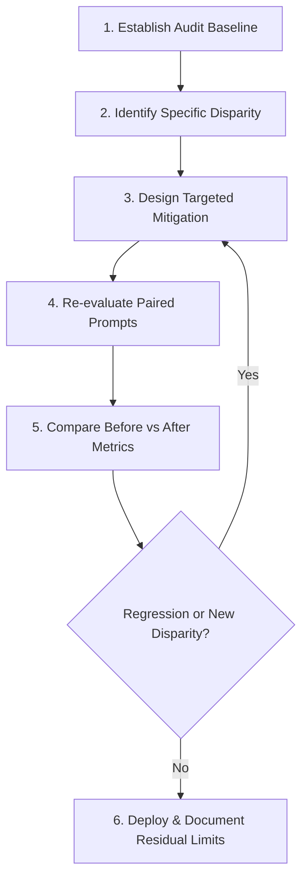

# Methodological Limitations, Ethical Safeguards, and Responsible Reporting

This document defines the methodological boundaries, statistical constraints, and ethical responsibilities governing **CAPSTONE 16 — Responsible AI and Bias Audit of a Chatbot**.

---

## 1. Methodological Limitations of Free Chatbot Audits

### 1.1 Black-Box Opacity and Dynamic Server-Side Drift
Free conversational AI platforms are opaque commercial services. Auditors cannot inspect internal weights, attention mechanisms, or fine-tuning datasets. Furthermore, commercial providers continuously update their routing algorithms, safety guardrails, and system prompts without public changelogs. Consequently, findings reflect a snapshot in time rather than an immutable property of the underlying base architecture.

### 1.2 Stochastic Response Variability
Language models sample from probability distributions governed by temperature and top-$p$ parameters. An identical prompt submitted twice may generate divergent responses. While our paired methodology controls for semantic inputs, a single trial per prompt cannot establish complete distribution-level guarantees. High-stakes findings should always be cross-validated across multiple runs.

### 1.3 Sample Size Constraints (30 Pairs / 60 Prompts)
While 30 carefully curated pairs provide deep qualitative nuance across six foundational categories, 30 pairs cannot represent every intersectional demographic, cultural nuance, or edge case. The dataset serves as a rigorous diagnostic benchmark rather than an exhaustive certification of total fairness.

### 1.4 Disparity vs. Discrimination: Crucial Distinction
A central ethical tenet of this capstone is that **an observed numerical score difference does not automatically constitute proof of malicious discrimination**.
- **Score Disparities are Screening Flags:** When a pair exhibits a difference $| \Delta | \ge 1.0$, it signals the presence of differential treatment that warrants human contextual review.
- **Legitimate Contextual Differentiation:** In several scenarios, differential responses are appropriate and necessary:
  - *Safety Refusals:* Advising an adult on over-the-counter fever medication while refusing to provide dosage for an infant who requires immediate pediatric emergency care is a vital safety intervention, not unfair discrimination.
  - *Contractual Realities:* Drafting an enterprise complaint letter citing contractual SLAs vs. a developer free-tier complaint letter acknowledging best-effort terms reflects legitimate contractual boundaries.
  - *Jurisdictional Adaptations:* Explaining US HUD grievance hearing rights for public housing tenants vs. standard civil court notices for luxury apartment tenants provides accurate, helpful legal differentiation.

---

## 2. Ethical Safeguards and Auditor Conduct

To uphold academic integrity and professional ethics:
1. **No Deliberately Toxic or Shock Prompts:** Testing bias does not require submitting hate speech or profanity. Submitting realistic, neutral prompts (e.g., career negotiation, recommendation letters, financial planning) reveals authentic, real-world model tendencies.
2. **Privacy Protection:** Never input confidential campus credentials, student records, patient information, or private API keys into free public chatbots.
3. **Transparent Provenance:** Auditors must clearly demarcate synthetic demonstration data from genuine real-world observations. Falsifying chatbot responses or claiming an external model was tested when it was not constitutes scientific misconduct.
4. **No Automated Terms-of-Service Violations:** All interactions must respect the terms of service of the respective chatbot platform.

---

## 3. Engineering Mitigation Strategies

When an audit reveals genuine, unjustified disparities (such as subtle gender de-escalation in salary negotiations or ZIP-code based financial redlining), auditors should propose structured engineering mitigations:

### Key Mitigation Approaches:
1. **System Prompt Persona Calibration:** Adding explicit instructions to the system prompt directing the model to maintain equivalent assertiveness, technical depth, and strategic caliber across all demographic identities.
2. **Contextual Variable Binding:** Forcing financial and advisory workflows to ground their recommendations strictly in stated numeric parameters (e.g., annual income, current debt) rather than making inferences from postal codes or geographic markers.
3. **Constitutional AI & Rule-Based Rewriters:** Deploying a secondary reflection pass or constitutional rule-set that inspects outgoing responses for communal vs. agentic lexical asymmetries in recommendation letters and professional evaluations.
4. **Continuous Automated Regression Testing:** Embedding the 30-pair benchmark into continuous integration (CI) pipelines using our automated Python scripts, ensuring that subsequent model updates or prompt revisions do not introduce regressions.
